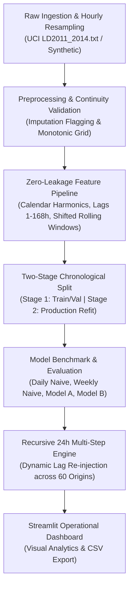

# ⚡ AI-Powered Energy Consumption Forecasting System

A production-grade, test-driven machine learning system for forecasting hourly commercial and facility electricity demand. Built with rigorous time-series feature engineering, zero-leakage shifted rolling statistics, out-of-sample chronological evaluation, and an interactive Streamlit operational dashboard.

[](https://www.python.org/downloads/)
[](https://creativecommons.org/licenses/by/4.0/)
[](tests/)
[](docs/architecture.md)

---

## 1. Project Overview & Problem Statement

Accurate short-term electricity load forecasting (24 hours ahead) is critical for modern power grid reliability and commercial energy management:
- **Peak Demand Tariff Penalties**: Commercial and industrial electricity bills incur substantial capacity charges based on the maximum demand window ($\text{kW}$) within a billing cycle. Anticipating peak hours enables peak-shaving and equipment rescheduling.
- **Grid Dispatch & Spinning Reserves**: Utility operators require day-ahead unit commitment and spinning reserve planning to balance fluctuating demand with minimum generation costs.
- **Facility HVAC Scheduling**: Pre-cooling or pre-heating buildings during off-peak tariff windows lowers aggregate operating expenditures.

### Core Objectives
1. **Develop an Operational Baseline (Model A)**: Build an autonomous pure autoregressive Random Forest model capable of outperforming standard utility benchmarks (24h Daily Naive and 168h Weekly Naive persistence) on real-world smart meter telemetry.
2. **Eliminate Data Leakage**: Implement mathematical guarantees ensuring no future observations contaminate historical lags or rolling statistics.
3. **Conduct Controlled Scientific Experiments**: Rigorously investigate whether incorporating external ambient temperature (Model B) adds predictive value over pure autoregression, adhering to scientific skepticism rather than assuming weather always helps.
4. **Deliver Portfolio-Ready Engineering**: Provide an automated test suite (47 unit tests), clean CLI automation, reproducible data pipelines, and an interactive decision-support dashboard.

---

## 2. Key Features & System Workflow

- **Dual Ingestion Engine**: Supports both physics-informed synthetic simulations (with baseload, shift schedules, and HVAC thermal dynamics) and real-world smart meter data (UCI ElectricityLoadDiagrams).
- **Zero-Leakage Feature Engineering**: Computes calendar coordinates, cyclical harmonics ($\sin/\cos$), 5 autoregressive lags ($1\text{h}, 2\text{h}, 24\text{h}, 48\text{h}, 168\text{h}$), and shifted rolling statistics (6h, 12h, 24h, 168h rolling mean/std) strictly applying `.shift(1)` to eliminate lookahead bias.
- **Two-Stage Chronological Protocol**: Separate development/validation split (July–October 2014) for hyperparameter confirmation, followed by production refit on all pre-test data prior to evaluating the untouched holdout test partition (November–December 2014).
- **Dual-Tier Baseline Benchmarking**: Benchmarks machine learning models against both 24-hour daily persistence and 168-hour weekly persistence.
- **Recursive Multi-Step Forecaster**: Autonomous 24-hour recursive forecasting engine ($t+1 \dots t+24$) that feeds step predictions dynamically into downstream autoregressive inputs without ground truth leakage.
- **Interactive Streamlit Dashboard**: Web interface with KPI scorecards, interactive forecast curves, historical time-series exploration, and one-click CSV export.



---

## 3. Dataset Provenance, Attribution & Limitations

The repository supports two distinct data sources:

### 3.1 Primary Real-World Benchmark: UCI ElectricityLoadDiagrams2011–2014
- **Official Source**: [UCI Machine Learning Repository](https://archive.ics.uci.edu/dataset/321/electricityloaddiagrams20112014)
- **Dataset DOI**: [`10.24432/C58C86`](https://doi.org/10.24432/C58C86)
- **License**: Creative Commons Attribution 4.0 International (CC BY 4.0)
- **Original Authors**: Artur Trindade, Vitório Carvalho, Przemyslaw Biecek, Alfredo Serrano (INESC Porto / EDP Distribuição)
- **Dataset Scope**: Electricity consumption of 370 Portuguese consumers logged at 15-minute intervals from 2011 to 2014.
- **Selected Meter (`MT_320`)**: Selected via multi-criterion audit: 100% telemetry continuity across the 2012–2014 active window (26,304 consecutive hourly observations), zero missing records, mean load of 102.31 kW, and standard deviation of 28.28 kW.
- **Anonymization Caveat**: Client `MT_320` is an anonymized utility customer. The load profile exhibits distinct commercial-scale business-hour diurnal patterns, but is documented strictly as empirical smart-meter telemetry without assuming an unverified industrial sub-classification.
- **Measurement Units Convention**: Telemetry values represent **average power** over the interval in kilowatts ($\text{kW}$). Hourly interval energy consumption in kilowatt-hours is:
  $$E_{\text{hour}} = \bar{P}_{\text{hour}} \times 1.0\text{ h} \quad [\text{kWh}]$$
  Power ($\text{kW}$) and energy ($\text{kWh}$) are mathematically distinct and never conflated.

### 3.2 Controlled Weather Experiment: Open-Meteo ERA5 Reanalysis
- **API Provider**: [Open-Meteo Historical Weather API](https://archive-api.open-meteo.com/v1/archive)
- **Reanalysis Model**: ECMWF ERA5 (Copernicus Climate Change Service)
- **License**: Creative Commons Attribution 4.0 International (CC BY 4.0)
- **Geographic Proxy**: Lisbon, Portugal (`38.7223° N`, `-9.1393° W`, elevation ~66m).
- **Proxy Limitation**: Because official UCI client addresses are anonymized to protect privacy, Lisbon was chosen as the national grid anchor. Microclimate differences between Lisbon and the true client facility introduce spatial proxy variance; Lisbon weather is strictly a geographic proxy, not a verified local facility microclimate.

### 3.3 Synthetic Facility Simulation
- Synthesizes 730 days (17,520 hours) modeling continuous baseload (80 kW), two-shift production schedules, ambient temperature HVAC heating/cooling response ($7.5\text{ kW}/^\circ\text{C}$ cooling, $5.2\text{ kW}/^\circ\text{C}$ heating), and Gaussian noise.

---

## 4. Architecture & Repository Structure

```
AI-Powered Energy Consumption Forecasting/
├── data/
│   ├── raw/                        # Large raw archives (excluded from git via .gitignore)
│   ├── processed/                  # Cleaned, resampled hourly datasets (CSV)
│   └── README.md                   # Data storage policy and regeneration instructions
├── docs/
│   ├── README.md                   # Central documentation directory index
│   ├── architecture.md             # System architecture and data flow diagrams
│   ├── data_dictionary.md          # Complete schema definition, units, and ranges
│   ├── dataset_selection.md        # Public dataset comparative evaluation matrix
│   ├── methodology.md              # Modeling rationale, equations, and temporal audit
│   └── limitations.md              # Boundary assumptions, warm-up needs, and future scope
├── images/                         # Application figures and screenshots
├── models/                         # Serialized model bundles (.joblib)
├── outputs/
│   ├── metrics/                    # Machine-readable evaluation JSONs
│   ├── predictions/                # Holdout predictions and recursive forecast CSVs
│   └── figures/                    # Generated visualization figures
├── notebooks/
│   └── 01_exploratory_data_analysis.ipynb # Exploratory data analysis
├── src/
│   ├── __init__.py
│   ├── config.py                   # Dynamic path resolution and model hyperparameters
│   ├── data_generation.py          # Physics-informed synthetic data synthesizer
│   ├── preprocessing.py            # Timestamp validation, gap reindexing, and audit flags
│   ├── features.py                 # Calendar, lag, and shifted rolling window feature engine
│   ├── train.py                    # Chronological split, baseline vs. ML training & serialization
│   ├── evaluation.py               # MAE, RMSE, WAPE, and R2 calculation with zero-handling
│   ├── forecast.py                 # Recursive multi-step 24-hour forecaster
│   ├── public_dataset.py           # UCI ElectricityLoadDiagrams ingestion, resampling, and DST
│   └── weather.py                  # Open-Meteo ERA5 weather integration & controlled experiment
├── tests/
│   ├── __init__.py
│   ├── test_preprocessing.py       # Ingestion, duplicates, and imputation tests
│   ├── test_features.py            # Lags, calendar coordinates, and zero-leakage tests
│   ├── test_evaluation.py          # Metric mathematical contracts and zero-handling
│   ├── test_forecast.py            # Recursive inference and metadata preservation
│   ├── test_public_dataset.py      # UCI ingestion, DST aggregation, and reproducibility
│   └── test_weather.py             # Weather alignment, operational fallback, and precision
├── main.py                         # Unified command-line interface orchestrator
├── app.py                          # Streamlit interactive operational dashboard
├── requirements.txt                # Pinned runtime and testing dependencies
├── .gitignore                      # Excludes raw data archives (>250MB) and virtual envs
└── README.md                       # Project portfolio documentation (this file)
```

---

## 5. Installation & Environment Setup

### Prerequisites
- Python 3.10, 3.11, or 3.12
- Git

### Step-by-Step Setup
```bash
# 1. Clone the repository
git clone https://github.com/<your-username>/AI-Powered-Energy-Consumption-Forecasting.git
cd "AI-Powered-Energy-Consumption-Forecasting"

# 2. Create a clean virtual environment
python -m venv .venv

# 3. Activate the virtual environment
# Windows (PowerShell):
.venv\Scripts\Activate.ps1
# Windows (cmd.exe):
.venv\Scripts\activate.bat
# Linux / macOS:
source .venv/bin/activate

# 4. Install dependencies
pip install --upgrade pip
pip install -r requirements.txt
```

---

## 6. Execution Instructions

The project provides a unified CLI via [`main.py`](main.py):

### 6.1 Official Public Dataset Pipeline (UCI Electricity `MT_320`)
```bash
# Option A: Run complete public pipeline in one command (process -> train -> forecast):
python main.py --all-public --meter MT_320

# Option B: Run stage-by-stage:
# 1. Download official UCI 249MB ZIP and extract LD2011_2014.txt:
python main.py --download-uci

# 2. Resample 15-minute readings to canonical 1-hour interval bins:
python main.py --process-public --meter MT_320

# 3. Train Model A (Two-stage chronological holdout + 24h recursive rolling-origin test):
python main.py --train-public --meter MT_320

# 4. Generate next-24h forecast for 2015-01-01:
python main.py --forecast-public --meter MT_320
```

### 6.2 Controlled Weather Experiment Pipeline (Model B)
```bash
# Execute full weather pipeline (fetch ERA5 cache -> align -> train Model B -> evaluate):
python main.py --all-weather
```

### 6.3 Synthetic Facility Simulation Pipeline
```bash
# Execute full synthetic facility pipeline:
python main.py --all

# Or individual synthetic stages:
python main.py --generate-data --days 730 --seed 42
python main.py --preprocess
python main.py --train
python main.py --forecast
```

### 6.4 Launch the Interactive Streamlit Dashboard
```bash
streamlit run app.py
```
*The dashboard allows switching between the Synthetic Facility, the Official Operational Baseline (Model A), and the Weather Experiment (Model B).*

### 6.5 Run Automated Tests & Code Checks
```bash
# Run complete test suite (47 passed unit tests):
pytest -v

# Run bytecode compilation check:
python -m compileall src tests main.py app.py
```

---

## 7. Evaluation Methodology & Chronological Splitting Protocol

Randomized K-fold cross-validation is strictly avoided in this system because randomly shuffling temporal records introduces catastrophic lookahead leakage. Instead, the system uses a **Two-Stage Chronological Benchmark Protocol**:

```
[============================= STAGE 1: DEVELOPMENT =============================]
[---- Training Partition (21,720 hrs) ----] [--- Validation Partition (2,952 hrs) ---]
(2012-01-08 to 2014-06-30)                   (2014-07-01 to 2014-10-31)

[============================= STAGE 2: PRODUCTION REFIT ===========================] [=== HOLDOUT TEST ===]
[----------------- Combined Pre-Test Training Partition (24,672 hrs) -----------------] [ 1,464 test hours  ]
(2012-01-08 to 2014-10-31)                                                              (2014-11-01 to 12-31)
```

1. **Stage 1 — Development & Validation (Pre-Test Split)**:
   - **Training Window**: `2012-01-08 00:00:00` to `2014-06-30 23:00:00` (21,720 valid hourly samples after 168h warm-up dropna).
   - **Validation Window**: `2014-07-01 00:00:00` to `2014-10-31 23:00:00` (2,952 hourly records / 4 months).
   - **Purpose**: Confirm lag structure and Random Forest hyperparameters (`n_estimators=100`, `max_depth=14`, `min_samples_split=5`) without touching the holdout test set.
   - *Diagnostic Validation Performance*: MAE = **4.84 kW**, RMSE = **6.54 kW**, WAPE = **4.37%**, $R^2$ = **0.9630**.
2. **Stage 2 — Production Refit & Final Holdout Benchmark**:
   - **Combined Pre-Test Training Window**: `2012-01-08 00:00:00` to `2014-10-31 23:00:00` (24,672 valid hourly samples).
   - **Final Holdout Test Partition**: `2014-11-01 00:00:00` to `2014-12-31 23:00:00` (61 days / 1,464 hourly records).
   - **Protocol**: The confirmed architecture is refit across all pre-test data to integrate the most recent seasonal transitions prior to evaluating the untouched November–December 2014 holdout.

---

## 8. Benchmark Evaluation Results

### 8.1 UCI Meter `MT_320` Out-of-Sample Holdout Results

The table below presents the verified results on the untouched holdout test partition (`2014-11-01` to `2014-12-31`), distinguishing immediate **one-step ahead ($t+1$)** predictions from **recursive 24-hour multi-step forecasting ($t+1 \dots t+24$)**:

| Model Architecture | Evaluation Protocol | MAE (kW) | RMSE (kW) | WAPE (%) | $R^2$ Score | Evaluated Test Points |
| :--- | :--- | :---: | :---: | :---: | :---: | :---: |
| **Baseline 1 (Daily Persistence)** | One-Step Naive Benchmark ($\hat{y}_{t+1} = y_{t-23}$) | 6.64 | 11.99 | 7.21% | 0.8037 | 1,464 hours |
| **Baseline 2 (Weekly Persistence)** | One-Step Naive Benchmark ($\hat{y}_{t+1} = y_{t-167}$) | 6.47 | 10.52 | 7.03% | 0.8489 | 1,464 hours |
| **Model A (Pure Autoregressive)** | **One-Step-Ahead ($t+1$) Holdout** | **4.30** | **6.52** | **4.67%** | **0.9419** | **1,464 hours** |
| **Model B (Weather-Aware)** | One-Step-Ahead ($t+1$) Holdout | 4.29 | 6.58 | 4.67% | 0.9410 | 1,464 hours |
| **Model A (Pure Autoregressive)** | **Recursive 24h Rolling-Origin** | **5.17** | **8.87** | **5.61%** | **0.8917** | **1,440 pts (60 origins)** |
| **Model B (Weather-Aware Exp 1)** | Recursive 24h (Retrospective ERA5 Reanalysis) | 5.12 | 8.78 | 5.56% | 0.8940 | 1,440 pts (60 origins) |
| **Model B (Weather-Aware Exp 2)** | Recursive 24h (Operational Diurnal Persistence) | 5.19 | 8.84 | 5.64% | 0.8926 | 1,440 pts (60 origins) |

### 8.2 Key Analytical Observations
1. **Model A vs. Naive Baselines**: Model A reduces WAPE by **35.23%** (from 7.21% to 4.67%) and RMSE by **45.60%** (from 11.99 kW to 6.52 kW) relative to the 24-hour daily persistence baseline.
2. **One-Step vs. Recursive Evaluation**:
   - In one-step evaluation ($t+1$), the model receives true observed consumption up to $t$.
   - In recursive 24-hour evaluation ($t+1 \dots t+24$), true future consumption is strictly withheld; step predictions are fed dynamically into downstream autoregressive lag inputs.
   - Error accumulates predictably across the multi-step horizon: $h=+1$ (2.14 kW) $\rightarrow$ $h=+6$ (3.99 kW) $\rightarrow$ $h=+12$ (6.16 kW) $\rightarrow$ $h=+18$ (6.68 kW), before stabilizing at $h=+24$ (5.95 kW) as the 24-hour lag re-anchors to observed history.

---

## 9. Transparent Weather Experiment Summary & Operational Decision

To test the hypothesis that external ambient temperature provides predictive lift for commercial electricity demand, Model B was enriched with 2 additional weather features: `temperature_c` and `temperature_c_lag_1` (26 features total vs. 24 features in Model A).

### 9.1 Feature Importance Findings
Random Forest Gini importance across all 26 features reveals:
- `load_kw_lag_24`: **47.21%** (Primary daily rhythm)
- `load_kw_lag_168`: **37.21%** (Primary weekly cycle)
- `load_kw_lag_1`: **10.44%** (Short-term inertia)
- *Combined Autoregressive Lags*: **94.86%**
- `temperature_c`: **0.2689%** (Rank 11 of 26)
- `temperature_c_lag_1`: **0.1693%** (Rank 16 of 26)
- *Total Weather Feature Importance*: **0.4382%** (< 0.5%)

### 9.2 Operational Policy Decision
1. **Negligible Predictive Gain**: Demand for meter `MT_320` is overwhelmingly driven by calendar schedules, day-of-week routines, and recent consumption inertia (>94.8% importance). Outdoor temperature provides zero meaningful reduction in holdout WAPE (4.67% vs 4.67%).
2. **Operational Degradation**: In a realistic operational environment where day-ahead Numerical Weather Prediction (NWP) archives are unavailable, future weather must be approximated via 24-hour diurnal persistence ($\hat{T}_{t+h} = T_{t+h-24}$). Under these conditions, Model B slightly degrades recursive multi-step WAPE from **5.61%** to **5.64%**.
3. **Operational Model Retention**:
   - **Model A (Pure Autoregressive)** is officially frozen and retained as the production operational baseline.
   - **Model B (Weather-Aware)** is cataloged as a documented research experiment.
   - Retrospective ERA5 evaluations are classified as diagnostic hindcasts, ensuring zero lookahead leakage in operational claims.

### 9.3 Serialization Precision Note
An audit of metric recalculation demonstrated that saved JSON metrics are computed from unrounded 64-bit float arrays during training (`MAE = 4.29919452 kW` $\rightarrow$ `4.2992 kW`), whereas prediction CSVs round predictions to 2 decimal places (`np.round(..., 2)`) for readability. Recalculating metrics from 2-decimal rounded CSV text yields `MAE = 4.2991 kW` ($\Delta \approx 0.0001\text{ kW}$ or $< 0.003\%$). Both calculations evaluate the identical 1,464 test rows.

---

## 10. Limitations, Reproducibility Notes & Future Scope

### Known Limitations
1. **Single-Meter Scope**: Evaluation is grounded on Portuguese utility client `MT_320`. While confirming pipeline functionality, multi-step autoregressive dynamics, and baseline outperformance, results on a single meter cannot be assumed to generalize universally across all 370 consumers without cohort benchmarking.
2. **Anonymized Consumer Metadata**: `MT_320` is an anonymized utility smart meter. It is not confirmed as an industrial facility in official metadata and is documented strictly as empirical smart-meter telemetry.
3. **Geographic Weather Proxy & Reanalysis Limitations**: Lisbon coordinates (`38.7223° N`, `-9.1393° W`) were selected as a national grid proxy because `MT_320` contains no published client coordinates. Microclimate variance between Lisbon and the true client facility introduces spatial proxy noise. Furthermore, Open-Meteo ERA5 data is retrospective reanalysis; operational multi-step forecasting cannot observe future reanalysis and relies on diurnal persistence.
4. **Daylight Saving Time (DST) Logger Telemetry Semantics**: The raw Portuguese dataset records telemetry on a fixed 96-interval calendar grid every day. Spring transition contains placeholder readings (~0.60 kW) and Autumn transition aggregates two hours into one slot. Because the grid operator's internal dispatch clock cannot be independently verified from public metadata, observed data is preserved faithfully as recorded rather than artificially manipulated.
5. **Cold Start Warm-Up**: A minimum history of 168 continuous hours (7 days) is required to compute weekly autoregressive lags.
6. **Recursive Error Compounding**: In multi-step recursive forecasting without ground truth, errors compound across the horizon ($h=+1$ MAE: 2.14 kW $\rightarrow$ $h=+18$ MAE: 6.68 kW $\rightarrow$ $h=+24$ MAE: 5.95 kW).

### Git Tracking & Storage Notes
- **Large Data Policy**: The raw UCI archive (`data/raw/LD2011_2014.txt`, ~770 MB) and raw ZIP archive (~249 MB) are excluded via `.gitignore` to adhere to GitHub's 100 MB file limit.
- **Model Binaries**: The pre-trained Random Forest models (`models/*.joblib`, ~36 MB each) are tracked in `.gitignore` by default. They can be reproduced at any time via `python main.py --train-public` and `python main.py --train-weather`.
- **Metrics and Prediction Artifacts**: All benchmark metric JSONs and holdout prediction CSVs are tracked in git for transparency and instant review.

### Future Improvements
1. **Numerical Weather Prediction (NWP) Forecast Integration**: Ingest real-time day-ahead weather forecasts rather than relying on diurnal persistence fallback.
2. **Advanced Multi-Horizon Architectures**: Benchmark deep sequence models (e.g. Temporal Fusion Transformer, N-BEATS, PatchTST) against Baseline v1.
3. **Multi-Meter Cohort Clustering**: Group the remaining 369 UCI meters into industrial, commercial, and residential clusters to evaluate weather sensitivity across consumer types.

---

## 📄 License & Attribution

- **Source Code & Original Materials**: The project source code, pipelines, analysis scripts, and original documentation are released under the [MIT License](LICENSE).
- **Third-Party Dataset Licensing & Attribution**: Third-party datasets and telemetry referenced or ingested by this project are not relicensed under MIT and retain their official open data licenses:
  - **Public Electricity Telemetry**: [UCI ElectricityLoadDiagrams20112014](https://archive.ics.uci.edu/dataset/321/electricityloaddiagrams20112014) is licensed under [Creative Commons Attribution 4.0 International (CC BY 4.0)](https://creativecommons.org/licenses/by/4.0/) (Trindade, 2015, DOI: [10.24432/C58C86](https://doi.org/10.24432/C58C86)).
  - **Weather Reanalysis Telemetry**: [Open-Meteo Historical Weather API](https://open-meteo.com/) (ECMWF ERA5) is licensed under [Creative Commons Attribution 4.0 International (CC BY 4.0)](https://creativecommons.org/licenses/by/4.0/).
