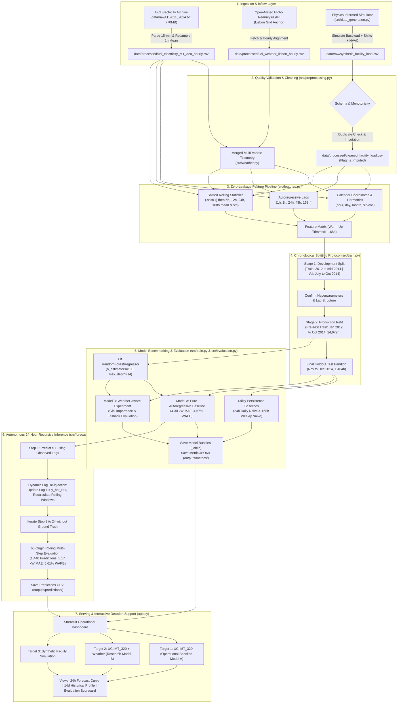

# System Architecture & Technical Flow

This document details the system architecture, component interactions, data lifecycle, and storage topology for the **AI-Powered Energy Consumption Forecasting System**.

---

## 1. High-Level Architecture Diagram



---

## 2. Core Modules & Responsibilities

| Module | Source File | Responsibilities | Key Dependencies |
| :--- | :--- | :--- | :--- |
| **Configuration** | [`src/config.py`](../src/config.py) | Centralizes dynamic absolute path resolution, directory anchors, hyperparameter defaults, and feature lists. | `os`, `pathlib` |
| **Data Generation** | [`src/data_generation.py`](../src/data_generation.py) | Synthesizes physics-informed commercial facility load, shift patterns, HVAC cooling/heating dynamics, and Gaussian noise. | `numpy`, `pandas`, `config` |
| **Preprocessing** | [`src/preprocessing.py`](../src/preprocessing.py) | Validates schema integrity, rejects duplicate timestamps and negative loads, enforces an unbroken hourly grid, and applies audit-logged interpolation. | `pandas`, `config` |
| **Feature Engineering** | [`src/features.py`](../src/features.py) | Constructs calendar coordinates, cyclical harmonics, 5 autoregressive lags, and shifted rolling statistics with strict zero-leakage contracts. | `numpy`, `pandas`, `config` |
| **Evaluation** | [`src/evaluation.py`](../src/evaluation.py) | Computes regression evaluation metrics (MAE, RMSE, WAPE, $R^2$) with safe zero-denominator handling. | `numpy`, `sklearn.metrics` |
| **Training Pipeline** | [`src/train.py`](../src/train.py) | Executes chronological train/test splits, fits Random Forest models, and serializes metadata-rich `.joblib` bundles. | `sklearn.ensemble`, `joblib`, `features`, `evaluation` |
| **Recursive Forecasting** | [`src/forecast.py`](../src/forecast.py) | Iteratively predicts 24 hours ahead, feeding prior step predictions dynamically into downstream lag inputs without future target leakage. | `pandas`, `joblib`, `features` |
| **Public Dataset Pipeline** | [`src/public_dataset.py`](../src/public_dataset.py) | Ingests 770 MB raw UCI telemetry, detects client connection spans, resamples 15-minute readings to hourly bins, and runs two-stage benchmark evaluations. | `pandas`, `features`, `train`, `evaluation`, `forecast` |
| **Weather Experiment** | [`src/weather.py`](../src/weather.py) | Ingests and caches Open-Meteo ERA5 temperature reanalysis, aligns timestamps, trains Model B, audits Gini feature importance, and benchmarks operational diurnal persistence. | `urllib`, `json`, `pandas`, `features`, `train`, `evaluation` |
| **CLI Orchestrator** | [`main.py`](../main.py) | Provides a unified command-line interface with modular execution flags (`--all`, `--all-public`, `--all-weather`). | `argparse`, `src.*` |
| **Interactive Dashboard** | [`app.py`](../app.py) | Delivers a multi-target operational Streamlit application with KPI scorecards, interactive forecast curves, historical exploration, and CSV export. | `streamlit`, `pandas`, `matplotlib`, `joblib` |

---

## 3. End-to-End Data Lifecycle

### 3.1 Raw Ingestion & Aggregation
- **Synthetic Mode**: Generates 730 days (17,520 hours) of continuous facility load combining baseload (80 kW), two-shift operations (~220 kW), HVAC thermal response ($7.5\text{ kW}/^\circ\text{C}$ cooling, $5.2\text{ kW}/^\circ\text{C}$ heating), and Gaussian noise.
- **UCI Smart-Meter Benchmark**: Streams `LD2011_2014.txt` (semicolon-delimited, comma decimal format). Resamples four 15-minute interval observations per hour to 1-hour canonical bins via arithmetic mean:
  $$\bar{P}_{\text{hour}} = \frac{1}{4}\sum_{i=1}^4 P_{15\text{m}, i} \quad [\text{kW}]$$
  Because 1 hour of average power in kilowatts ($\text{kW}$) equals 1 kilowatt-hour ($\text{kWh}$), this guarantees physical energy equivalence.

### 3.2 Preprocessing & Quality Verification
- **Strict Monotonicity**: Verifies that timestamps advance in strict 1-hour increments (`freq="1h"`).
- **Duplicate Timestamp Rejection**: Immediate `ValueError` if duplicate timestamps appear.
- **Physical Boundary Verification**: Enforces non-negative consumption ($\ge 0.0\text{ kW}$).
- **Audit-Logged Imputation**: Missing intervals are filled via linear interpolation and tracked with a boolean column `is_imputed = True`.

### 3.3 Zero-Leakage Feature Pipeline
- **Calendar Signals**: Discrete indices (`hour`, `day_of_week`, `day_of_month`, `month`, `is_weekend`) and trigonometric cyclical harmonics:
  $$\text{hour\_sin} = \sin\left(\frac{2\pi \cdot \text{hour}}{24}\right), \quad \text{hour\_cos} = \cos\left(\frac{2\pi \cdot \text{hour}}{24}\right)$$
  $$\text{day\_sin} = \sin\left(\frac{2\pi \cdot \text{day}}{7}\right), \quad \text{day\_cos} = \cos\left(\frac{2\pi \cdot \text{day}}{7}\right)$$
  $$\text{month\_sin} = \sin\left(\frac{2\pi \cdot (\text{month}-1)}{12}\right), \quad \text{month\_cos} = \cos\left(\frac{2\pi \cdot (\text{month}-1)}{12}\right)$$
- **Autoregressive Lags**: $y_{t-1}, y_{t-2}, y_{t-24}, y_{t-48}, y_{t-168}$.
- **Shifted Rolling Windows**: 6h, 12h, 24h, and 168h rolling mean and standard deviation. Crucially, `.shift(1)` is applied before rolling window aggregation:
  $$\mu_{t, W} = \frac{1}{W}\sum_{i=1}^W y_{t-i}$$
  Ensuring that feature calculations at time $t$ depend exclusively on historical data $\le t-1$.
- **Warm-Up Trimming**: The first 168 hourly rows containing `NaN`s from the weekly lag are dropped.

### 3.4 Two-Stage Chronological Splitting Protocol
1. **Stage 1 (Development & Validation Split)**:
   - Training: `2012-01-08 00:00:00` to `2014-06-30 23:00:00` (21,720 valid hours).
   - Validation: `2014-07-01 00:00:00` to `2014-10-31 23:00:00` (2,952 hours / 4 months).
   - Purpose: Confirm hyperparameter choices (`n_estimators=100`, `max_depth=14`, `min_samples_split=5`) without touching the test set.
2. **Stage 2 (Production Refit & Final Holdout Benchmark)**:
   - Pre-Test Training: `2012-01-08 00:00:00` to `2014-10-31 23:00:00` (24,672 valid hours).
   - Final Holdout Test: `2014-11-01 00:00:00` to `2014-12-31 23:00:00` (1,464 hours / 61 continuous days).
   - Protocol: Refit the confirmed model architecture across all pre-test data to incorporate recent seasonal transitions before evaluating the untouched holdout test partition.

### 3.5 Autonomous 24-Hour Recursive Inference
- At step $h=1$, predict $\hat{y}_{t+1}$ using observed history up to $t$.
- Append $\hat{y}_{t+1}$ to historical state.
- At step $h=2$, recalculate lag 1 ($=\hat{y}_{t+1}$), lag 2 ($=y_t$), and rolling statistics, then predict $\hat{y}_{t+2}$.
- Repeat through $h=24$.
- Evaluated across 60 rolling origins on the holdout partition (1,440 predictions).

---

## 4. Artifact Storage & Versioning Topology

```
AI-Powered Energy Consumption Forecasting/
├── data/
│   ├── raw/                        # Large raw archives (excluded from git via .gitignore)
│   │   ├── LD2011_2014.txt         # Raw UCI text dataset (~770 MB)
│   │   └── data.zip                # Raw UCI download archive (~249 MB)
│   ├── processed/                  # Cleaned, resampled hourly datasets (excluded via .gitignore)
│   │   ├── uci_electricity_MT_320_hourly.csv
│   │   └── uci_weather_lisbon_hourly.csv
│   └── README.md                   # Data regeneration policies and attribution
├── models/                         # Serialized model bundles (excluded via .gitignore)
│   ├── uci_forecaster_rf.joblib    # Protected Baseline v1 Model Bundle (~36 MB)
│   └── uci_forecaster_rf_weather.joblib # Research Experiment Model Bundle (~36 MB)
├── outputs/
│   ├── metrics/                    # Machine-readable evaluation JSONs (Tracked in Git)
│   │   ├── uci_model_metrics.json  # Official Baseline v1 Metrics
│   │   └── uci_weather_model_metrics.json # Model B Comparative Metrics
│   ├── predictions/                # Holdout predictions and forecasts (Tracked in Git)
│   │   ├── next_24h_forecast.csv   # Synthetic 24-hour forecast
│   │   ├── uci_next_24h_forecast.csv # Model A official 24-hour forecast
│   │   ├── uci_test_set_predictions.csv # Model A one-step holdout predictions
│   │   └── uci_weather_recursive_predictions.csv # 60-origin recursive predictions
│   └── figures/                    # Generated visualization figures
├── images/                         # Genuine dashboard screenshots (Tracked in Git)
└── src/                            # Modular production source code
```

---

## 5. Failure Modes & Defensive Engineering

1. **Missing Exogenous Weather Feeds**: If real-time weather APIs fail in production, the engine falls back to 24-hour diurnal persistence ($\hat{T}_{t+h} = T_{t+h-24}$).
2. **Cold-Start Warm-Up Handling**: A strict validation check verifies that at least 168 hours of continuous history are provided. If fewer than 168 hours are passed, the engine raises `ValueError: Insufficient history: required >= 168 hours`.
3. **Historical Continuity Defense**: In `app.py`, historical actuals are dynamically filtered to select the 48 hours immediately preceding `forecast_df["timestamp"].min()`, preventing horizontal axis compression or multi-year gaps.
