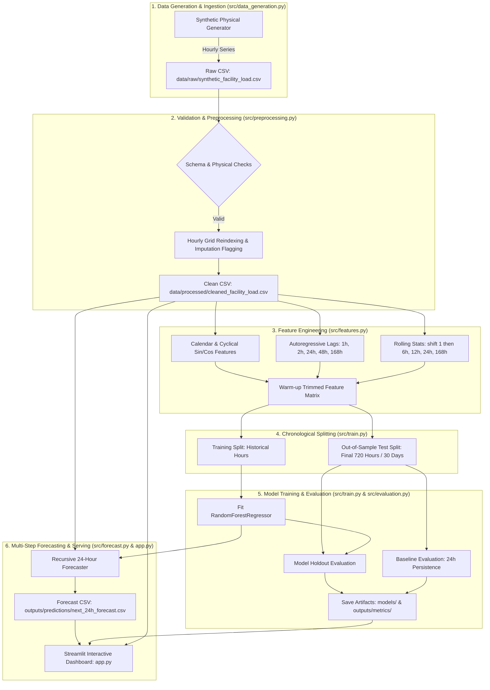

# System Architecture & Technical Flow

This document details the system architecture, component interactions, and data lifecycle for the **AI-Powered Energy Consumption Forecasting System**.

---

## 1. High-Level Architecture Diagram

---

## 2. Core Modules & Responsibilities

| Module | Source File | Responsibilities |
| :--- | :--- | :--- |
| **Configuration** | [`src/config.py`](../src/config.py) | Centralizes dynamically derived project paths, feature hyperparameters, and execution settings. |
| **Data Generation** | [`src/data_generation.py`](../src/data_generation.py) | Simulates realistic facility electricity load, seasonal temperatures, and production shifts. |
| **Preprocessing** | [`src/preprocessing.py`](../src/preprocessing.py) | Validates datatypes, rejects duplicate timestamps and negative values, and resolves hourly continuity gaps. |
| **Feature Engineering** | [`src/features.py`](../src/features.py) | Constructs calendar coordinates, autoregressive lags, and shifted rolling statistics with zero lookahead leakage. |
| **Evaluation** | [`src/evaluation.py`](../src/evaluation.py) | Computes MAE, RMSE, WAPE, and R² with explicit zero-denominator handling. |
| **Training Pipeline** | [`src/train.py`](../src/train.py) | Executes chronological train/test splits, trains baseline and Random Forest models, and serializes metadata. |
| **Forecasting Engine** | [`src/forecast.py`](../src/forecast.py) | Recursively predicts 24 hours ahead, feeding prior step predictions into subsequent autoregressive windows. |
| **CLI Orchestrator** | [`main.py`](../main.py) | Provides modular CLI flags (`--all`, `--generate-data`, `--preprocess`, `--train`, `--forecast`). |
| **Web Dashboard** | [`app.py`](../app.py) | Delivers interactive Streamlit charts, metrics comparison, and CSV download. |

---

## 3. Data Integrity & Target Leakage Prevention

1. **Chronological Splitting**: Training and test partitions are separated strictly by time index. Shuffling is strictly disallowed.
2. **Rolling Window Alignment**: All rolling metrics compute `.shift(1).rolling(...)` so that feature values at time $t$ utilize observations up to $t-1$.
3. **Recursive Autoregressive Horizon**: For multi-step forecasting ($t+1, \dots, t+24$), future target observations are not available. The engine uses a recursive loop where the prediction $\hat{y}_{t+1}$ becomes the lag $y_{t+1}$ for subsequent steps.
