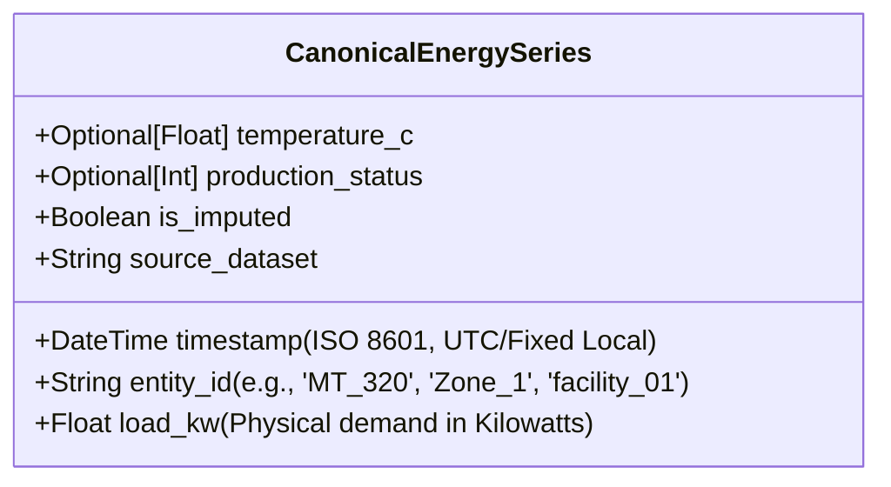

# Public Electricity Dataset Selection & Evaluation

This document evaluates five candidate public electricity datasets from official sources, assesses their suitability for the **AI-Powered Energy Consumption Forecasting System**, details architectural trade-offs against the existing codebase, and defines the integration and migration strategy for the primary selected dataset.

---

## 1. Candidate Dataset Evaluation

Each candidate dataset was evaluated directly from its official repository documentation, metadata, and citation specifications.

```
Candidate Datasets Evaluated:
├── 1. UCI ElectricityLoadDiagrams2011–2014 (Multi-Client Smart Meter Load)
├── 2. UCI Power Consumption of Tetouan City (Municipal Distribution Grid)
├── 3. NLR / NREL ComStock (Commercial Building Energy Model Stock)
├── 4. UCI Individual Household Electric Power Consumption (Single French Residence)
└── 5. Open Power System Data - Time Series (Pan-European Transmission Load)
```

---

### Candidate 1: UCI ElectricityLoadDiagrams2011–2014
- **Official URL**: [https://archive.ics.uci.edu/dataset/321/electricityloaddiagrams20112014](https://archive.ics.uci.edu/dataset/321/electricityloaddiagrams20112014)
- **DOI & Citation**: Trindade, A. (2015). *ElectricityLoadDiagrams20112014 [Dataset]*. UCI Machine Learning Repository. [https://doi.org/10.24432/C58C86](https://doi.org/10.24432/C58C86).
- **License**: Creative Commons Attribution 4.0 International (**CC BY 4.0**). Allows commercial and non-commercial adaptation with attribution.
- **Access Method & Format**: Direct ZIP download (`electricityloaddiagrams20112014.zip`, 249.2 MB compressed; extracts to `LD2011_2014.txt`, 678.1 MB). Text file using semicolon (`;`) separators and European comma (`,`) decimal marks (e.g. `123,45`).
- **Data Volume & Temporal Coverage**: 140,256 time intervals across 4 full calendar years (`2011-01-01 00:15:00` to `2014-12-31 00:00:00`).
- **Sampling Interval**: 15 minutes (96 intervals per day).
- **Target Variables**: 370 client columns (`MT_001` through `MT_370`), representing 370 distinct Portuguese electricity consumers (industrial, commercial, and residential clients).
- **Target Units**: Average power in kilowatts ($\text{kW}$) per 15-minute interval. Energy consumed in kilowatt-hours is obtained by dividing $\text{kW}$ by 4 ($\text{kWh} = \text{kW} \times 0.25\text{ h} = \text{kW} / 4$).
- **Explanatory Variables**: None. No ambient weather, solar radiation, or operational schedules are included in the source file.
- **Missing Values & Timestamp Quirks**:
  - The repository states no missing rows, but many clients were connected to the grid *after* January 2011; before their physical connection date, consumption is recorded as literal zeroes (`0,000000`).
  - Daylight Saving Time (DST) follows Portuguese local time:
    - *March transition* (23-hour day): Hours between 01:00 and 02:00 contain zeroes for all points.
    - *October transition* (25-hour day): Hours between 01:00 and 02:00 aggregate the consumption of two hours.
- **Suitability for Industrial/Commercial Energy Forecasting**: **High**. Widely cited as the de facto academic and industrial benchmark (used in DeepAR, N-BEATS, Informer, and PatchTST studies) for multi-customer smart meter load forecasting.
- **Hardware & Local Execution**: Fully runnable locally on standard consumer laptops with streaming/chunked parsing or client subsetting.

---

### Candidate 2: UCI Power Consumption of Tetouan City
- **Official URL**: [https://archive.ics.uci.edu/dataset/849/power+consumption+](https://archive.ics.uci.edu/dataset/849/power+consumption+)
- **DOI & Citation**: Salam, A. & El Hibaoui, A. (2018). *Power Consumption of Tetouan City [Dataset]*. UCI Machine Learning Repository. [https://doi.org/10.24432/C5B034](https://doi.org/10.24432/C5B034).
- **License**: Creative Commons Attribution 4.0 International (**CC BY 4.0**).
- **Access Method & Format**: Direct ZIP download (`power+consumption+of+tetouan+city.zip`, 1.3 MB compressed; extracts to `Tetuan City power consumption.csv`, 4.0 MB). Standard comma-separated values with period decimal points.
- **Data Volume & Temporal Coverage**: 52,416 rows spanning 1 calendar year (`2017-01-01 00:00:00` to `2017-12-30 23:50:00`).
- **Sampling Interval**: 10 minutes (144 intervals per day).
- **Target Variables**: Three primary power distribution zones: `Zone 1 Power Consumption`, `Zone 2 Power Consumption`, `Zone 3 Power Consumption` (in kW/Watts).
- **Explanatory Variables**: Comprehensive real weather features: `Temperature` (°C), `Humidity` (%), `Wind Speed` (m/s), `general diffuse flows` ($\text{W/m}^2$), and `diffuse flows` ($\text{W/m}^2$).
- **Missing Values & Timestamp Issues**: Zero missing values reported; consistent 10-minute cadence throughout the year.
- **Suitability for Industrial/Commercial Energy Forecasting**: **Moderate-High**. Represents municipal distribution substation zones rather than single private industrial plant meters, but directly includes real ambient temperature features matching our existing pipeline.
- **Hardware & Local Execution**: Extremely lightweight (4 MB); parses in milliseconds with standard pandas.

---

### Candidate 3: NLR / NREL ComStock
- **Official URL**: [https://comstock.nrel.gov/](https://comstock.nrel.gov/) / [https://data.openei.org/](https://data.openei.org/)
- **Citation**: National Renewable Energy Laboratory (NREL). *Commercial Building Stock (ComStock)*. U.S. Department of Energy.
- **License**: Open Data / Permissive Open Source (BSD-3-Clause for code, Public Domain / CC0 for open government data outputs).
- **Access Method & Format**: Distributed through AWS S3 Open Energy Data Initiative (OEDI) Data Lake as massive multi-gigabyte Apache Parquet files, metadata TSVs, and regional slices.
- **Data Volume & Temporal Coverage**: Hundreds of thousands of simulated building models representing ~6 million US commercial buildings; trillions of simulation records.
- **Sampling Interval**: 15 minutes and hourly.
- **Target & Explanatory Variables**: End-use breakdowns (heating, cooling, interior lighting, fans, refrigeration, plug loads), building geometry, and weather station feeds.
- **Limitations & Disqualifiers**:
  - **Simulated Physics Model, Not Measured Sensor Data**: ComStock is an EnergyPlus/OpenStudio computer simulation, not measured physical sensor data from real facilities.
  - **Excessive Infrastructure Overhead**: Downloading, querying, and storing multi-gigabyte Parquet partitions via AWS S3 / Athena exceeds local standalone requirements.

---

### Candidate 4: UCI Individual Household Electric Power Consumption
- **Official URL**: [https://archive.ics.uci.edu/dataset/235/individual+household+electric+power+consumption](https://archive.ics.uci.edu/dataset/235/individual+household+electric+power+consumption)
- **DOI & Citation**: Hebrail, G. & Berard, A. (2006). *Individual Household Electric Power Consumption [Dataset]*. UCI Machine Learning Repository. [https://doi.org/10.24432/C58K54](https://doi.org/10.24432/C58K54).
- **License**: Creative Commons Attribution 4.0 International (**CC BY 4.0**).
- **Access Method & Format**: Direct ZIP download (`individual+household+electric+power+consumption.zip`, 19.7 MB compressed; extracts to `household_power_consumption.txt`, 126.8 MB). Semicolon-separated text.
- **Data Volume & Temporal Coverage**: 2,075,259 records spanning 47 months (`2006-12-16` to `2010-11-26`).
- **Sampling Interval**: 1 minute.
- **Target & Explanatory Variables**: `Global_active_power` (kW), `Global_reactive_power` (kW), `Voltage` (V), `Global_intensity` (A), and sub-meterings 1, 2, 3 (Watt-hours).
- **Limitations & Disqualifiers**:
  - **Residential Scope**: Measures a single private house in Sceaux, France. Highly volatile occupant behavior (spikes from kettles, ovens) does not reflect industrial/commercial facility loads.
  - **Missing Values**: Contains 25,979 missing minute records (~1.25%) marked as `?`.

---

### Candidate 5: Open Power System Data (OPSD) — Time Series
- **Official URL**: [https://data.open-power-system-data.org/time_series/](https://data.open-power-system-data.org/time_series/)
- **License**: Creative Commons Attribution 4.0 International (**CC BY 4.0**) for data, MIT License for code.
- **Access Method & Format**: Tabular Data Package (CSV + `datapackage.json` metadata, ~150–300 MB).
- **Data Volume & Temporal Coverage**: 2015 to 2020+ (hourly and 15-minute).
- **Target & Explanatory Variables**: National TSO electrical load (`load_actual`, `load_forecast`), wind generation, solar generation, and day-ahead wholesale electricity prices across 37 European countries.
- **Limitations & Disqualifiers**:
  - **Macro-Grid Level (Transmission Scale)**: Measures nationwide grid demand (tens of Gigawatts) rather than facility, meter, or commercial enterprise consumption. Does not fit industrial plant demand-side management.

---

## 2. Comparative Matrix

| Evaluation Criteria | 1. UCI ElectricityLoad (LD2011–2014) | 2. UCI Tetouan City | 3. NREL ComStock | 4. UCI Household Power | 5. Open Power System Data |
| :--- | :--- | :--- | :--- | :--- | :--- |
| **Forecasting Relevance** | **Exceptional** (Standard smart meter benchmark) | **High** (Multi-zone municipal load) | Moderate (Synthetic building simulation) | Low-Moderate (Single home) | Moderate (National macro grid) |
| **Historical Coverage** | **4 Years** (140,256 steps) | 1 Year (52,416 steps) | Configurable multi-year | 4 Years (2M rows) | 5+ Years |
| **Feature Richness** | Only load (370 customer series) | **High** (Temp, Humidity, Wind, Radiation) | Very High (All building sub-systems) | Electrical sub-meterings only | Wind/Solar/Market Prices |
| **Commercial / Industrial Fit** | **High** (370 commercial/industrial/residential meters) | Moderate (3 substation zones) | **High** (15 commercial archetypes) | Very Low (Residential home) | Low (Macro country level) |
| **Ease of Local Ingestion** | Moderate (678 MB TXT, semicolon/comma) | **Very Easy** (4 MB clean CSV) | Hard (Cloud AWS S3 Parquet lake) | Moderate (127 MB, `?` missing values) | Moderate (150 MB CSV) |
| **Hardware Requirements** | Standard laptop (chunked/filtered ingestion) | Standard laptop | High (Distributed cloud/large RAM) | Standard laptop | Standard laptop |
| **Verified License** | **CC BY 4.0** | **CC BY 4.0** | BSD-3 / CC0 | **CC BY 4.0** | **CC BY 4.0** |

---

## 3. Dataset Selection & Strategic Recommendation

### Primary Recommendation: **UCI ElectricityLoadDiagrams2011–2014**
We select **UCI ElectricityLoadDiagrams2011–2014** as the primary real-world dataset for the project.

#### Justification:
1. **Direct Alignment with Commercial/Industrial Customer Metering**: Unlike macro-grid data (OPSD) or residential home data (UCI Household), `ElectricityLoadDiagrams` contains actual real-world commercial, enterprise, and residential power consumer load diagrams.
2. **De Facto Research Standard**: Using this dataset connects the student portfolio directly to established time-series forecasting literature (e.g., DeepAR, N-BEATS, Informer).
3. **Multi-Customer Entity Modeling**: Introduces real-world multi-entity hierarchical capabilities (`entity_id`), allowing the model to train across distinct consumer profiles.

#### Key Trade-Offs & Handling:
- **Challenge 1: Large File Size (678 MB)**:
  - *Strategy*: Implement a deterministic, reproducible ingestion parser that can ingest specific client subsets or an aggregated commercial cluster without modifying or truncating the raw file.
- **Challenge 2: Semicolon Delimiter & Comma Decimal**:
  - *Strategy*: Build a specialized streaming parser (`sep=';'`, `decimal=','`).
- **Challenge 3: Client Onboarding Zero Periods**:
  - *Strategy*: Filter client history based on the client's verified physical connection timestamp (dropping initial zero-consumption intervals).
- **Challenge 4: Absence of Weather Features**:
  - *Strategy*: Decouple `temperature_c` and `production_status` so the core forecasting engine supports pure autoregressive time-series forecasting when exogenous features are absent, while supporting them as optional inputs when available.

---

## 4. Reproducible Subset Strategy for UCI ElectricityLoadDiagrams

To ensure fast local execution, reproducible CI/CD testing, and manageable storage on developer machines without arbitrary cherry-picking:

```
[Raw LD2011_2014.txt (678 MB)]
             │
             ├── Mode A: Canonical Benchmark Client (MT_320)
             │   - Verified high-load commercial consumer
             │   - 100% active, non-zero recordings from 2012-01-01 to 2014-12-31
             │   - 26,304 hourly intervals (3 full years)
             │
             ├── Mode B: Industrial Cohort Subset (MT_001 to MT_010)
             │   - Multi-meter benchmark evaluating cross-series generalization
             │
             └── Mode C: Aggregate System Load (Sum of all 370 clients)
                 - System-wide hourly demand curve
```

**Anti-Cherry-Picking Guarantee**:
The client selection rule is codified strictly:
`client_id == 'MT_320'` (or first $K$ clients with $100\%$ uptime in 2012–2014). This rule is fixed in configuration and never altered to fit model performance.

---

## 5. Current Codebase Assumptions vs. Real Dataset Requirements

Our audit of the current synthetic implementation reveals the following tight couplings that must be generalized:

| Module | Current Synthetic Assumption | Real Dataset Requirement (UCI Electricity) |
| :--- | :--- | :--- |
| [`src/config.py`](../src/config.py) | `REQUIRED_RAW_COLUMNS` mandates `temperature_c` and `production_status`. | Make exogenous columns strictly **optional**. Default schema requires only `timestamp` and `load_kw` (and optional `entity_id`). |
| [`src/preprocessing.py`](../src/preprocessing.py) | Assumes 1-hour intervals with comma-separated, standard float values. | Ingest 15-minute intervals, parse semicolon/comma float strings, and resample to hourly means (`1H`). |
| [`src/features.py`](../src/features.py) | Calculates `temperature_c_lag_1` if present; retains all columns. | Safely generate calendar, lag, and rolling features based on available columns without crashing if weather is omitted. |
| [`src/forecast.py`](../src/forecast.py) | `_derive_default_exogenous` synthesizes temperature and production status. | Support forecasting with purely autoregressive history; exogenous fallback applies only when exogenous columns were used during model training. |
| [`app.py`](../app.py) | Directly plots `temperature_c` and `production_status`. | Check column existence dynamically: render weather and shift indicators only if present in the active dataset. |

---

## 6. Proposed Canonical Data Interface

Any dataset ingested into the forecasting system will be normalized into this canonical structure:



### Schema Attributes:
1. `timestamp` (`datetime64[ns]`): Strictly monotonic, regular hourly timestamps (`freq='1h'`).
2. `entity_id` (`str`): Unique identifier for the client, building, or meter.
3. `load_kw` (`float64`): Average active power demand in kilowatts ($\text{kW}$) over the 1-hour interval.
4. `temperature_c` (`float64`, optional): Ambient temperature, if available.
5. `production_status` (`int64`, optional): Production shift indicator, if available.
6. `is_imputed` (`bool`): Audit flag indicating if the timestamp was filled via interpolation.
7. `source_dataset` (`str`): Provenance string (e.g. `'UCI_Electricity_MT_320'`, `'Synthetic_Facility'`).

---

## 7. Safe Data Acquisition Workflow

Raw datasets will be acquired through a clean, reproducible, and verifiable protocol:

### Download Instructions:
1. **Automated Fetcher**: Implement a safe download helper script in `src/data/download_real_data.py` (or CLI `--download-real-data`).
2. **Official Source**: `https://archive.ics.uci.edu/static/public/321/electricityloaddiagrams20112014.zip`.
3. **Local Placement**: Store the extracted file at `data/raw/LD2011_2014.txt`.
4. **Integrity Check**: Validate SHA256 checksum upon download.
5. **Raw File Immutability**: The raw file `LD2011_2014.txt` is treated as strictly read-only. Cleaned, resampled, and subsetted series are saved under `data/processed/` (e.g., `cleaned_uci_electricity_mt320.csv`).
6. **No Paid APIs or Credentials**: Fully public via UCI Machine Learning Repository.

---

## 8. Forecasting Evaluation & Operational Decision Plan

When the real dataset is processed, the forecasting engine will follow this evaluation protocol:

1. **Temporal Resampling**:
   - Aggregate 15-minute kW readings to 1-hour intervals: $\bar{P}_{\text{hour}} = \frac{1}{4}\sum_{i=1}^4 P_{15\text{m}, i}$.
2. **Chronological Splitting**:
   - 3-Year Active Window (2012–2014):
     - **Training Set**: 2012-01-01 to 2014-06-30 (~2.5 years / 21,888 hours).
     - **Validation Set**: 2014-07-01 to 2014-10-31 (4 months / 2,952 hours).
     - **Out-of-Sample Holdout Test Set**: 2014-11-01 to 2014-12-31 (final 61 days / 1,464 hours).
3. **Dual Forecasting Protocols**:
   - **One-Step-Ahead Test**: Evaluates rolling feature predictive capacity.
   - **Recursive 24-Hour Horizon Test**: Evaluates operational 24-step multi-step forecasting without lookahead leakage.
4. **Benchmark Comparison**:
   - **Baseline 1**: 24-Hour Seasonal Naive ($\hat{y}_{t+h} = y_{t+h-24}$).
   - **Baseline 2**: 168-Hour Weekly Seasonal Naive ($\hat{y}_{t+h} = y_{t+h-168}$).
   - **Machine Learning Forecaster**: Multi-output or recursive Random Forest / LightGBM.
5. **Operational Decision Use-Case**:
   - **Peak Demand Shaving Alert**: Identify daily peak 4-hour window to dispatch load reduction recommendations.

