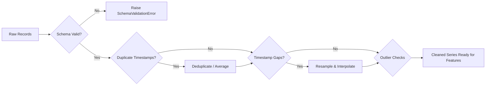

# Dataset Specification & Preprocessing Pipeline

This document defines the schema, source options, ingestion rules, cleaning protocols, and feature engineering transformations for the **AI-Powered Energy Consumption Forecasting** project.

---

## 1. Target Datasets

The architecture is designed to be data-agnostic while natively supporting standard energy benchmark datasets:

| Dataset Identifier | Granularity | Primary Target | Description |
| :--- | :--- | :--- | :--- |
| **PJM Hourly Energy Consumption** | Hourly (`1H`) | `MW` (Megawatts) | Regional power grid consumption across various US transmission zones (PJME, AEP, COMED, etc.). |
| **UCI Household Electric Power** | Minute / Resampled `1H` | `kW` (Kilowatts) | Individual household active/reactive power readings with sub-metering breakdown. |
| **Synthetic / Custom Time Series** | Configurable | `kW` / `MW` | Custom user-supplied CSV files adhering to the canonical schema. |

---

## 2. Canonical Schema Definition

Any input dataset ingested into the forecasting pipeline must conform to (or be mapped to) the following schema:

| Column Name | Data Type | Required | Description |
| :--- | :--- | :--- | :--- |
| `timestamp` | `datetime64[ns]` | Yes | Datetime index (ISO 8601, UTC or localized timezone with explicit offset). |
| `consumption` | `float64` | Yes | Target metric representing energy or power demand. |
| `temperature` | `float64` | Optional | Ambient outdoor temperature (key exogenous driver for heating/cooling loads). |
| `humidity` | `float64` | Optional | Relative humidity percentage (affects cooling demand). |
| `is_holiday` | `int64` / `bool` | Optional | Indicator for public holidays (distinct consumption patterns from regular weekdays). |

---

## 3. Data Cleaning & Validation Rules

1. **Duplicate Resolution**: If multiple records exist for the same timestamp, records are either verified for identity or aggregated via mean with a warning logged.
2. **Missing Interval Handling**:
   - The series is re-indexed against an uninterrupted fixed-frequency date range (`pd.date_range`).
   - Short gaps ($\le 3$ intervals): Imputed using linear or cubic spline interpolation.
   - Long gaps ($> 3$ intervals): Forward-filled with season-matching intervals ($t - 24\text{h}$ or $t - 168\text{h}$) to preserve cyclical properties.
3. **Physical Constraints & Anomaly Detection**:
   - Consumption values $\le 0$ (or below physical minimum for the grid) are treated as sensor errors unless explicitly representing net bidirectional metering.
   - Outliers are detected using rolling Z-scores ($|z| > 3.5$) and Hampel filtering.

---

## 4. Feature Engineering Strategy

To empower machine learning and deep learning models to capture complex periodicity, the following feature set is derived:

### Temporal / Calendar Signals
- **Cyclical Encoding**:
  $$\text{hour\_sin} = \sin\left(\frac{2\pi \cdot \text{hour}}{24}\right), \quad \text{hour\_cos} = \cos\left(\frac{2\pi \cdot \text{hour}}{24}\right)$$
  $$\text{month\_sin} = \sin\left(\frac{2\pi \cdot \text{month}}{12}\right), \quad \text{month\_cos} = \cos\left(\frac{2\pi \cdot \text{month}}{12}\right)$$
- **Discrete Indicators**: `day_of_week` (0–6), `is_weekend` (0/1), `is_holiday` (0/1).

### Autoregressive (Lag) Features
Captures autocorrelation and diurnal/weekly periodicity:
- $y_{t-1}, y_{t-2}, y_{t-3}$ (short-term momentum)
- $y_{t-24}$ (exact prior day same hour)
- $y_{t-48}$ (two days prior)
- $y_{t-168}$ (prior week same hour)

### Rolling Window Aggregations
- Rolling Mean & Rolling Std: Windows of 6h, 12h, 24h, and 168h computed strictly over prior historical points:
  $$\mu_{t, W} = \frac{1}{W} \sum_{i=1}^W y_{t-i}$$
  *(Ensures no future leakages occur into the feature calculation).*

