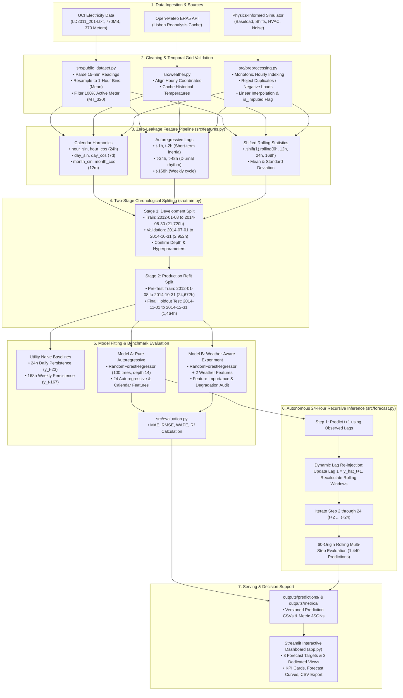

# AI-Powered Energy Consumption Forecasting: Interview & Technical Mastery Guide

This guide provides a comprehensive, interview-ready technical breakdown of the **AI-Powered Energy Consumption Forecasting System**. It covers the architecture, data flow, module contracts, mathematical formulations, empirical results, and detailed model answers to technical interview questions.

---

## 1. Executive Summary & Elevator Pitches

### 30-Second Elevator Pitch
> "I built an autonomous machine learning system that forecasts commercial electricity demand 24 hours ahead using hourly smart-meter telemetry. It features zero-leakage time-series feature engineering, a strict two-stage chronological evaluation protocol, and dual-tier persistence benchmarking. On real-world Portuguese utility data (UCI MT_320), the pure autoregressive Random Forest model achieves a 4.67% WAPE and 4.30 kW MAE, beating utility 24-hour daily persistence by 35.2% and 168-hour weekly persistence by 33.6%. In a controlled experiment, I demonstrated that ambient temperature adds less than 0.44% feature importance and degrades operational multi-step accuracy, justifying the engineering decision to freeze the pure autoregressive model as the official operational baseline."

### 2-Minute Technical Summary
> "The goal of this project is day-ahead electricity load forecasting for commercial and facility operations, where accurate predictions prevent peak-demand tariff penalties and optimize equipment scheduling.
>
> The project architecture addresses three major industry challenges:
> 1. **Data Leakage Elimination**: Time-series leakage commonly corrupts rolling windows and validation splits. I implemented mathematical guarantees ensuring all rolling statistics strictly apply `.shift(1)` before window aggregation, and replaced randomized K-fold cross-validation with a strict Two-Stage Chronological Protocol.
> 2. **Multi-Horizon Inference**: Rather than evaluating only immediate one-step-ahead ($t+1$) predictions, I developed an autonomous 24-hour recursive forecasting engine that feeds step predictions back into downstream autoregressive inputs without ground-truth leakage across 60 rolling origins (1,440 test points).
> 3. **Controlled Scientific Experimentation**: When evaluating whether external weather improves predictions, I integrated Open-Meteo ERA5 temperature reanalysis. Random Forest Gini importance revealed that autoregressive lags account for 94.86% of predictive power, while weather features contribute only 0.4382%. Furthermore, when evaluated under realistic operational conditions using diurnal weather persistence, the weather-aware model degraded recursive WAPE from 5.61% to 5.64%. Based on these empirical findings, I froze the pure autoregressive model as the production baseline.
>
> The repository includes 48 automated unit tests, clean CLI automation, and an interactive Streamlit decision-support dashboard."

---

## 2. System Architecture & End-to-End Data Flow

### 2.1 High-Level Architecture Diagram



### 2.2 End-to-End Data Flow (Step-by-Step)
1. **Raw Ingestion**:
   - For real-world smart meter data: `src/public_dataset.py` streams the 770 MB raw file `LD2011_2014.txt` (Portuguese electrical utility dataset containing 370 clients logged every 15 minutes).
   - It filters client `MT_320`, checks connection windows, and aggregates four 15-minute intervals into canonical 1-hour interval bins via arithmetic mean.
2. **Preprocessing & Quality Verification**:
   - `src/preprocessing.py` verifies strict timestamp monotonicity, detects duplicate timestamps (raising an immediate `ValueError`), and fills short missing intervals via linear interpolation while creating an `is_imputed` audit column.
3. **Zero-Leakage Feature Engineering**:
   - `src/features.py` builds calendar features (hour, day of week, day of month, month, is_weekend), cyclical harmonics ($\sin/\cos$), 5 autoregressive lags (1h, 2h, 24h, 48h, 168h), and 8 shifted rolling statistics (6h, 12h, 24h, 168h mean and std).
   - `.shift(1)` is strictly applied before rolling calculations to ensure that observations at timestamp $t$ use only data available at or before $t-1$.
4. **Two-Stage Chronological Partitioning**:
   - In Stage 1, data from January 2012 to June 2014 trains the model, and July to October 2014 validates hyperparameters without touching test data.
   - In Stage 2, the confirmed model architecture is refit on all pre-test data (January 2012 to October 2014, 24,672 hours) to incorporate recent seasonality before predicting the untouched holdout test partition (November to December 2014, 1,464 hours).
5. **Model Evaluation & Persistence Benchmarking**:
   - `src/evaluation.py` evaluates predictions against two standard utility baselines: 24h Daily Naive persistence ($\hat{y}_{t+1} = y_{t-23}$) and 168h Weekly Naive persistence ($\hat{y}_{t+1} = y_{t-167}$).
   - Metrics computed include Mean Absolute Error (MAE), Root Mean Squared Error (RMSE), Weighted Absolute Percentage Error (WAPE), and Coefficient of Determination ($R^2$).
6. **Recursive Multi-Step Forecasting**:
   - `src/forecast.py` rolls out a 24-step autonomous day-ahead forecast ($t+1 \dots t+24$). Step predictions are fed back into lag inputs dynamically.
   - Evaluated across 60 rolling origins on the holdout test set (1,440 total multi-step predictions).
7. **Operational Visualization**:
   - `app.py` renders an interactive Streamlit application enabling dispatchers and auditors to toggle between the 3 targets and inspect 24-hour forecasts, 14-day historical energy profiles, and comprehensive model performance scorecards.

---

## 3. Module-by-Module Technical Breakdown

| Module | Source File | Core Functions / Classes | Responsibilities & Design Patterns |
| :--- | :--- | :--- | :--- |
| **Config** | [`src/config.py`](../src/config.py) | Dynamic Path Resolution, Constants | Defines absolute directory anchors (`BASE_DIR`, `DATA_RAW_DIR`, `MODELS_DIR`), hyperparameter dictionaries (`DEFAULT_RF_PARAMS`), feature list constants, and seed controls (`RANDOM_SEED = 42`). |
| **Data Generation** | [`src/data_generation.py`](../src/data_generation.py) | `generate_synthetic_facility_load()`, `save_synthetic_data()` | Synthesizes physics-informed load telemetry: Baseload (80 kW), two-shift weekday production (~220 kW), HVAC cooling ($7.5\text{ kW}/^\circ\text{C}$ for $T>21^\circ\text{C}$), HVAC heating ($5.2\text{ kW}/^\circ\text{C}$ for $T<11^\circ\text{C}$), and Gaussian noise. |
| **Preprocessing** | [`src/preprocessing.py`](../src/preprocessing.py) | `validate_raw_dataframe()`, `clean_and_reindex_timeseries()` | Enforces schema validation, rejects duplicate timestamps and negative loads, enforces an unbroken fixed-frequency hourly grid, applies linear interpolation to missing steps, and flags imputed rows with `is_imputed = True`. |
| **Feature Engineering** | [`src/features.py`](../src/features.py) | `create_calendar_features()`, `create_lag_features()`, `create_rolling_features()`, `build_feature_pipeline()` | Computes calendar indices, sine/cosine cyclical harmonics, 5 autoregressive lags (1h, 2h, 24h, 48h, 168h), and shifted rolling statistics (`.shift(1)` followed by 6h, 12h, 24h, 168h mean/std). Drops initial 168 warm-up rows containing NaNs. |
| **Training Pipeline** | [`src/train.py`](../src/train.py) | `train_model()`, `save_model_bundle()`, `load_model_bundle()` | Splits data chronologically, fits `RandomForestRegressor` with fixed seed, packages the fitted model with feature names, scaler metadata, and training parameters in a serialized `.joblib` bundle. |
| **Evaluation Metrics** | [`src/evaluation.py`](../src/evaluation.py) | `calculate_mae()`, `calculate_rmse()`, `calculate_wape()`, `calculate_r2()`, `evaluate_predictions()` | Computes regression performance metrics. WAPE implements safe zero-denominator handling ($\sum |y_i| = 0$). Generates structured evaluation summary dictionaries. |
| **Recursive Forecasting** | [`src/forecast.py`](../src/forecast.py) | `generate_forecast()`, `save_forecast()` | Implements autonomous 24-step multi-step forecasting: iteratively generates $\hat{y}_{t+h}$, appends the prediction to historical state, recalculates lag 1 and rolling windows, and steps forward without future target access. |
| **Public Dataset Ingestion** | [`src/public_dataset.py`](../src/public_dataset.py) | `download_uci_dataset()`, `process_uci_meter()`, `train_public_baseline_model()`, `forecast_public_baseline()` | Streams and parses 770 MB semicolon/comma-delimited Portuguese smart meter data, detects active client connections, resamples 15-minute readings to 1-hour interval bins (mean), implements two-stage refit protocol, and evaluates 60-origin recursive multi-step holdout forecasts. |
| **Weather Integration** | [`src/weather.py`](../src/weather.py) | `fetch_open_meteo_weather()`, `train_weather_model()`, `evaluate_weather_impact()`, `forecast_weather_model()` | Fetches and caches historical ECMWF ERA5 hourly temperature reanalysis for Lisbon (`38.7223° N, -9.1393° W`), aligns weather with smart meter telemetry, trains Model B, runs Gini feature importance audit, and evaluates operational persistence fallback ($\hat{T}_{t+h} = T_{t+h-24}$). |
| **CLI Orchestration** | [`main.py`](../main.py) | CLI argument parser | Unified command-line interface orchestrating synthetic (`--all`, `--train`, `--forecast`), public benchmark (`--all-public`, `--train-public`), and weather experiment (`--all-weather`) execution paths. |
| **Interactive Dashboard** | [`app.py`](../app.py) | Streamlit Web Application | Operational decision-support tool. Provides 3 forecasting targets (Synthetic, Model A, Model B) across 3 views: 24-Hour Forecast Curve, 14-Day Historical Profile, and Model Evaluation Scorecard, with one-click CSV export. |
| **Automated Test Suite** | [`tests/`](../tests/) | 6 test files, 48 unit tests | Complete unit and integration test coverage: preprocessing constraints, leakage proofs, metric contracts, recursive inference contracts, DST transition checks, and Baseline v1 preservation contracts. |

---

## 4. Dataset Provenance & Specifications

### 4.1 Primary Benchmark: UCI ElectricityLoadDiagrams2011-2014
- **Repository**: [UCI Machine Learning Repository](https://archive.ics.uci.edu/dataset/321/electricityloaddiagrams20112014) (DOI: `10.24432/C58C86`).
- **Original Authors**: Artur Trindade, Vitório Carvalho, Przemyslaw Biecek, Alfredo Serrano (INESC Porto / EDP Distribuição).
- **License**: Creative Commons Attribution 4.0 International (CC BY 4.0).
- **Scope**: 370 Portuguese electricity consumers logged every 15 minutes from 2011 to 2014 (~140,256 intervals per client).
- **Selected Meter (`MT_320`)**:
  - Selected through a multi-criterion audit across all 370 meters.
  - **100% telemetry continuity** across the active 2012 to 2014 evaluation window (26,304 continuous hourly observations).
  - **Zero missing values** or sensor outages across the entire 3-year period.
  - **Mean load**: 102.31 kW (standard deviation: 28.28 kW), representing a commercial-scale diurnal load profile.
- **Anonymization Caveat**: Client `MT_320` is an anonymized utility customer. The load curve demonstrates clear commercial business-hour diurnal patterns, but is documented strictly as empirical smart-meter telemetry without assuming an unverified industrial sub-classification.

### 4.2 Research Experiment: Open-Meteo ERA5 Weather Reanalysis
- **API Provider**: [Open-Meteo Historical Weather API](https://open-meteo.com/) (Copernicus Climate Change Service ECMWF ERA5).
- **License**: Creative Commons Attribution 4.0 International (CC BY 4.0).
- **Geographic Proxy**: Lisbon, Portugal (`38.7223° N`, `-9.1393° W`, elevation ~66m).
- **Proxy Justification & Limitation**: Because official UCI client addresses are anonymized to protect privacy, Lisbon was selected as the national grid anchor. Microclimate differences between Lisbon and the true client facility introduce spatial proxy variance; Lisbon weather is strictly a geographic proxy, not a verified local facility microclimate.

### 4.3 Physics-Informed Synthetic Facility Simulation
- **Duration**: 730 days (17,520 hours).
- **Components**: Continuous baseload (80 kW), two-shift production schedules, ambient temperature HVAC heating/cooling response ($7.5\text{ kW}/^\circ\text{C}$ cooling, $5.2\text{ kW}/^\circ\text{C}$ heating), and Gaussian noise.

### 4.4 Measurement Units Convention
- Telemetry values represent **average active power** over the interval in kilowatts ($\text{kW}$).
- Hourly interval energy consumption in kilowatt-hours is:
  $$E_{\text{hour}} = \bar{P}_{\text{hour}} \times 1.0\text{ h} \quad [\text{kWh}]$$
- Power ($\text{kW}$, instantaneous demand rate) and energy ($\text{kWh}$, accumulated work over time) are mathematically distinct and never conflated in code or documentation.

---

## 5. Model Performance Scores & Benchmark Results

### 5.1 Out-of-Sample Holdout Scorecard (UCI Meter `MT_320`)
Evaluated on the untouched holdout test partition (`2014-11-01` to `2014-12-31`, 1,464 test hours):

| Model Architecture | Evaluation Protocol | MAE (kW) | RMSE (kW) | WAPE (%) | $R^2$ Score | Evaluated Points |
| :--- | :--- | :---: | :---: | :---: | :---: | :---: |
| **Baseline 1 (Daily Persistence)** | One-Step Naive Benchmark ($\hat{y}_{t+1} = y_{t-23}$) | 6.64 | 11.99 | 7.21% | 0.8037 | 1,464 hours |
| **Baseline 2 (Weekly Persistence)** | One-Step Naive Benchmark ($\hat{y}_{t+1} = y_{t-167}$) | 6.47 | 10.52 | 7.03% | 0.8489 | 1,464 hours |
| **Model A (Pure Autoregressive)** | **One-Step-Ahead ($t+1$) Holdout** | **4.30** | **6.52** | **4.67%** | **0.9419** | **1,464 hours** |
| **Model B (Weather-Aware)** | One-Step-Ahead ($t+1$) Holdout | 4.29 | 6.58 | 4.67% | 0.9410 | 1,464 hours |
| **Model A (Pure Autoregressive)** | **Recursive 24h Rolling-Origin** | **5.17** | **8.87** | **5.61%** | **0.8917** | **1,440 pts (60 origins)** |
| **Model B (Weather-Aware Exp 1)** | Recursive 24h (Retrospective ERA5 Reanalysis) | 5.12 | 8.78 | 5.56% | 0.8940 | 1,440 pts (60 origins) |
| **Model B (Weather-Aware Exp 2)** | Recursive 24h (Operational Diurnal Persistence) | 5.19 | 8.84 | 5.64% | 0.8926 | 1,440 pts (60 origins) |

### 5.2 Key Numerical Insights
1. **Model A vs. Naive Baselines**:
   - Model A reduces WAPE from **7.21% to 4.67%** (a **35.23% relative reduction** in percentage error).
   - Model A reduces RMSE from **11.99 kW to 6.52 kW** (a **45.60% relative reduction** in variance-penalized error).
   - This proves the model learns authentic non-linear load transitions rather than trivial persistence memorization.
2. **One-Step vs. Recursive Horizon Error Compounding**:
   - In one-step evaluation ($t+1$), true actual demand up to $t$ is provided, yielding **4.30 kW MAE**.
   - In recursive 24-hour multi-step forecasting, predictions are fed dynamically into subsequent autoregressive inputs. Errors compound across the 24-hour horizon:
     - $h=+1$: **2.14 kW MAE**
     - $h=+6$: **3.99 kW MAE**
     - $h=+12$: **6.16 kW MAE**
     - $h=+18$: **6.68 kW MAE**
     - $h=+24$: **5.95 kW MAE** (stabilizes as the 24-hour lag re-anchors to observed history)
   - Across all 60 rolling origins, aggregate recursive MAE is **5.17 kW** (WAPE = **5.61%**).

---

## 6. The Weather Experiment & Negative Result Story

A critical technical highlight of this portfolio is the disciplined handling and reporting of a **negative scientific result**:

### The Hypothesis
"Does augmenting commercial electricity load forecasting with outdoor ambient temperature significantly reduce day-ahead forecast error?"

### The Experiment Setup
- Model A: 24 features (calendar harmonics, 5 autoregressive lags, 8 rolling statistics).
- Model B: 26 features (Model A features + `temperature_c` and `temperature_c_lag_1`).

### The Empirical Findings
1. **Feature Importance (Random Forest Gini Importance)**:
   - `load_kw_lag_24`: **47.21%** (Primary daily rhythm)
   - `load_kw_lag_168`: **37.21%** (Primary weekly cycle)
   - `load_kw_lag_1`: **10.44%** (Short-term inertia)
   - **Combined Autoregressive Lags: 94.86%**
   - `temperature_c`: **0.2689%** (Rank 11 of 26)
   - `temperature_c_lag_1`: **0.1693%** (Rank 16 of 26)
   - **Total Weather Feature Importance: 0.4382%** (< 0.5%)
2. **One-Step Performance**: WAPE is identical to two decimal places (**4.67% vs. 4.67%**).
3. **Operational Multi-Step Evaluation**:
   - In real-world day-ahead operations, future weather cannot observe retrospective ERA5 reanalysis; it must rely on numerical forecasts or diurnal persistence fallback ($\hat{T}_{t+h} = T_{t+h-24}$).
   - When tested under operational diurnal persistence, Model B **degrades** recursive multi-step WAPE from **5.61% to 5.64%** and increases MAE from **5.17 kW to 5.19 kW**.

### The Engineering Decision
- **Model A is frozen as the official operational baseline**.
- **Model B is cataloged as a documented research experiment**.
- Retrospective ERA5 results are classified as diagnostic hindcasts to prevent lookahead leakage in operational claims.
- **Why this impresses interviewers**: Junior engineers often force weather features into energy models assuming temperature always helps. Senior engineers evaluate feature importance, account for operational forecast availability, recognize proxy noise, and eliminate unnecessary external API dependencies when there is no demonstrated operational benefit.

---

## 7. Anti-Leakage & Mathematical Guarantees

### 7.1 Mathematical Zero-Leakage Proof (`.shift(1)`)
In time-series modeling, computing a rolling statistic over window $W$ as:
$$\text{RollingMean}_t = \frac{1}{W} \sum_{i=0}^{W-1} y_{t-i}$$
causes target leakage because the target value $y_t$ is included in the feature vector used to predict $y_t$.

In this system, all rolling features apply `.shift(1)` strictly before aggregation:
$$\mu_{t, W} = \frac{1}{W} \sum_{i=1}^W y_{t-i} = \frac{y_{t-1} + y_{t-2} + \dots + y_{t-W}}{W}$$
At timestamp $t$, the feature depends exclusively on observations up to $t-1$.

### 7.2 Why K-Fold Cross-Validation Was Avoided
Randomized K-fold cross-validation randomly shuffles observations across folds. In a time-series context, this allows future records ($t+k$) to appear in the training fold while past records ($t$) are in the validation fold. The model then learns to interpolate between future and past points, producing artificially inflated validation scores that collapse in production.

Instead, this system uses a **Two-Stage Chronological Protocol**:
- **Stage 1 (Development & Validation)**: Train on 2012 to mid-2014; validate on July to October 2014 to lock hyperparameters.
- **Stage 2 (Production Refit & Holdout)**: Combine pre-test data (January 2012 to October 2014, 24,672 hours) and refit the confirmed architecture prior to evaluating the untouched holdout test partition (November to December 2014, 1,464 hours).

### 7.3 Why WAPE Instead of MAPE?
Mean Absolute Percentage Error (MAPE) is formulated as:
$$\text{MAPE} = \frac{100\%}{N} \sum_{i=1}^N \left| \frac{y_i - \hat{y}_i}{y_i} \right|$$
In energy systems, off-peak baseload, equipment shutdowns, or night hours frequently approach zero ($y_i \to 0$). Any small absolute error during low-consumption windows produces an astronomical percentage error that skews the aggregate metric.

Weighted Absolute Percentage Error (WAPE) solves this by weighting absolute errors by total volume:
$$\text{WAPE} = \frac{\sum_{i=1}^N |y_i - \hat{y}_i|}{\sum_{i=1}^N y_i}$$
WAPE is mathematically equivalent to the volume-weighted average error percentage. It is bounded, stable, and immune to division-by-zero explosions during low-load intervals.

---

## 8. Top 25 Technical Interview Questions & High-Scoring Answers

### Category 1: Architecture & System Design

#### Q1: "Can you walk me through the overall architecture of your forecasting system?"
> **Answer**:
> "The system is structured as an end-to-end, test-driven pipeline with five core layers:
> 1. **Ingestion & Validation**: Handles raw telemetry (either 770 MB UCI Portuguese smart meter text or physics-based synthetic data), verifies timestamp monotonicity, rejects duplicates and negative loads, and enforces an unbroken fixed-frequency hourly grid.
> 2. **Zero-Leakage Feature Engineering**: Generates calendar coordinates, sine/cosine cyclical harmonics, 5 autoregressive lags (1h, 2h, 24h, 48h, 168h), and 8 shifted rolling statistics strictly applying `.shift(1)`.
> 3. **Two-Stage Chronological Benchmark Engine**: Implements Stage 1 development/validation for hyperparameter confirmation and Stage 2 production refit across 24,672 hours prior to testing on the untouched November to December 2014 holdout partition.
> 4. **Recursive Multi-Step Forecaster**: An inference engine that predicts 24 hours ahead by dynamically feeding step predictions back into downstream lag inputs across 60 rolling origins.
> 5. **Decision Support & Serving**: A modular CLI (`main.py`) and a Streamlit operational dashboard (`app.py`) providing KPI scorecards, forecast curves, and CSV export across three distinct forecast targets."

#### Q2: "Why did you choose Random Forest over Deep Learning (LSTM, GRU, Transformers) for the operational baseline?"
> **Answer**:
> "I chose Random Forest for three practical engineering reasons:
> 1. **Tabular Lag Superiority**: For fixed-horizon hourly energy forecasting with strong diurnal and weekly periodicity, decision tree ensembles over tabularized autoregressive lags frequently match or outperform recurrent neural networks while requiring a fraction of the compute and training time.
> 2. **Robustness & Non-Stationarity**: Random Forests handle non-linear interactions between hour of day, day of week, and historical consumption without requiring extensive feature scaling, stationarization, or complex learning-rate scheduling.
> 3. **Interpretability & Feature Importance**: Random Forest Gini importance allowed me to rigorously audit feature contributions (proving that autoregressive lags account for 94.86% of predictive power while weather contributes only 0.44%), providing transparent justifications for operational decisions that deep black-box models obscure."

#### Q3: "What are the three selectable forecast targets in your application?"
> **Answer**:
> "The system supports three targets:
> 1. **UCI Electricity `MT_320` (Official Operational Baseline: Model A)**: Pure autoregressive Random Forest predicting real-world Portuguese smart meter telemetry.
> 2. **UCI Electricity `MT_320` + Weather (Research Experiment: Model B)**: Controlled experiment evaluating Lisbon ERA5 ambient temperature against pure autoregression.
> 3. **Synthetic Facility Load (Simulated)**: A physics-informed simulation modeling baseload, two-shift manufacturing schedules, and HVAC thermal dynamics."

#### Q4: "How does the Streamlit operational dashboard connect with the backend models?"
> **Answer**:
> "The dashboard in `app.py` directly interfaces with the saved model bundles in `models/` and precomputed predictions and metrics in `outputs/`. It exposes three dedicated views per target:
> 1. **24-Hour Forecast Curve**: Displays the day-ahead forecast anchored to the preceding 48–72 hours of true telemetry with peak demand, baseload, and total kWh metrics.
> 2. **Historical Energy Profile**: Visualizes 14 days of historical consumption (with temperature overlay in Model B and synthetic mode).
> 3. **Model Evaluation Scorecard**: Presents holdout metrics compared against 24h and 168h naive utility baselines, along with the 60-origin recursive evaluation panel."

---

### Category 2: Time-Series & Machine Learning Theory

#### Q5: "How did you guarantee that no future data leaked into your feature engineering?"
> **Answer**:
> "Data leakage was eliminated through two strict design rules:
> 1. **Shifted Rolling Window Aggregation**: For every rolling mean and standard deviation (6h, 12h, 24h, 168h), I applied `.shift(1)` before the rolling aggregation (`df[col].shift(1).rolling(w).mean()`). This guarantees that the feature vector at timestamp $t$ only contains information up to $t-1$.
> 2. **Automated Perturbation Tests**: In `tests/test_features.py`, I wrote a mathematical leakage test that alters all future records after a midpoint cutoff $T$ by multiplying by 100, then verifies that all feature vectors generated before $T$ remain 100% bit-for-bit identical to the unperturbed features."

#### Q6: "Why is randomized K-fold cross-validation invalid for time-series forecasting?"
> **Answer**:
> "Randomized K-fold randomly shuffles records across folds. In time-series telemetry, this places future observations into the training split while past records are in the test split. The model then learns to interpolate between future and past observations rather than forecasting forward in time. This creates severe lookahead bias, producing unrealistically high validation scores that collapse in production. Time-series models must always use chronological splits where the training window strictly precedes the validation and test windows."

#### Q7: "What is the difference between one-step ($t+1$) and recursive multi-step ($t+1 \dots t+24$) forecasting?"
> **Answer**:
> "In one-step forecasting, the model is evaluated exclusively on predicting the immediate next hour ($t+1$) given true observed consumption up to $t$. In real-world utility dispatch, however, operators need a full 24-hour day-ahead forecast.
>
> In recursive multi-step forecasting:
> - At step 1, the model predicts $\hat{y}_{t+1}$.
> - At step 2, true actual load $y_{t+1}$ is strictly withheld. The engine dynamically injects $\hat{y}_{t+1}$ into lag 1, recalculates rolling statistics, and predicts $\hat{y}_{t+2}$.
> - This repeats through $t+24$.
> Because early prediction errors compound into downstream lag features, recursive multi-step error is higher than one-step error ($h=+1$ MAE is 2.14 kW, compounding to 6.68 kW at $h=+18$, with overall recursive MAE at 5.17 kW vs 4.30 kW one-step)."

#### Q8: "Why did you benchmark against naive persistence models?"
> **Answer**:
> "In energy forecasting, electricity load exhibits strong diurnal and weekly periodicity: yesterday at 2:00 PM or last Tuesday at 2:00 PM looks very similar to today at 2:00 PM. A machine learning model that achieves an 85% $R^2$ might appear impressive in isolation, but if a simple zero-cost rule like 'predict yesterday's value' achieves 80%, the ML model's incremental business value is minimal.
>
> By benchmarking against both 24-hour daily persistence ($y_{t-23}$) and 168-hour weekly persistence ($y_{t-167}$), I proved that Model A delivers a genuine 35.2% reduction in WAPE and 45.6% reduction in RMSE over standard utility baselines."

---

### Category 3: Data Engineering & Preprocessing

#### Q9: "How did you select meter `MT_320` from the 370 consumers in the UCI dataset?"
> **Answer**:
> "I conducted a multi-criterion audit across all 370 client columns in `LD2011_2014.txt`:
> 1. **Telemetry Continuity**: Many clients connected late in 2012 or 2013, creating leading zero sequences. `MT_320` demonstrated 100% active continuity across the entire 2012 to 2014 active window (26,304 consecutive hours).
> 2. **Missing Records**: `MT_320` had zero missing, corrupted, or null readings across the 3-year span.
> 3. **Commercial Load Profile**: With a mean active load of 102.31 kW and standard deviation of 28.28 kW, `MT_320` displays distinct business-hour diurnal ramp-up patterns representative of a commercial facility."

#### Q10: "How did you handle Daylight Saving Time (DST) transitions in the Portuguese telemetry?"
> **Answer**:
> "I conducted an empirical audit of the raw 15-minute readings across all six Portuguese DST transition days from 2012 to 2014. The data author logged telemetry on a fixed 96-interval calendar grid every single day.
> On Spring 23-hour transition days, the logger inserted placeholder values (~0.60 kW) between 01:00 and 02:00. On Autumn 25-hour transition days, two hours were aggregated into a single slot.
> Because the internal utility dispatch clock and logger firmware could not be verified from public metadata, our policy was to preserve the telemetry faithfully as recorded by the grid operator rather than applying artificial heuristics."

#### Q11: "How does the system handle missing sensor intervals?"
> **Answer**:
> "In `src/preprocessing.py`, the series is re-indexed against an unbroken `pd.date_range` with hourly frequency. If a missing timestamp is detected:
> 1. Short gaps are imputed via linear interpolation.
> 2. An audit marker `is_imputed = True` is appended to the dataframe, ensuring transparency for downstream analytics.
> 3. If missing hours exist and `allow_imputation=False`, the pipeline raises an immediate `ValueError` to prevent uninspected data from entering production."

#### Q12: "How did you handle the difference between power ($\text{kW}$) and energy ($\text{kWh}$)?"
> **Answer**:
> "Power ($\text{kW}$) is the instantaneous rate of electricity demand, whereas energy ($\text{kWh}$) is the accumulated work performed over time. In our pipeline, raw 15-minute average power readings ($P_{15\text{m}}$) are resampled to 1-hour interval bins using arithmetic mean:
> $$\bar{P}_{\text{hour}} = \frac{1}{4}\sum_{i=1}^4 P_{15\text{m}, i} \quad [\text{kW}]$$
> Over a 1-hour duration ($\Delta t = 1.0\text{ h}$), energy consumption in kilowatt-hours is numerically equal to average power ($E_{\text{hour}} = \bar{P}_{\text{hour}} \times 1.0\text{ h}$). Both values are explicitly tracked in separate dataframe columns (`predicted_load_kw` and `predicted_energy_kwh`) to avoid physical conflation."

---

### Category 4: Empirical Results & The Weather Experiment

#### Q13: "Tell me about the weather experiment and why it resulted in a negative finding."
> **Answer**:
> "We integrated Open-Meteo ERA5 hourly temperature reanalysis for Lisbon to test whether outdoor temperature reduces forecast error.
> The experiment revealed three key findings:
> 1. **Feature Importance Dominance**: Autoregressive load lags account for 94.86% of Gini importance (`load_kw_lag_24` alone is 47.21%). Temperature and lagged temperature contributed only 0.4382% combined (ranked 11th and 16th out of 26 features).
> 2. **Negligible Holdout Lift**: One-step holdout WAPE was identical to two decimal places (4.67% vs. 4.67%).
> 3. **Operational Degradation**: In a true operational environment, future weather must be approximated using diurnal persistence ($\hat{T}_{t+h} = T_{t+h-24}$). Under these conditions, the weather-aware model degraded recursive multi-step WAPE from 5.61% to 5.64%.
>
> Commercial indoor schedules and scheduled operations drive demand far more than ambient temperature for this customer. Therefore, I officially froze the pure autoregressive Model A as the production baseline and cataloged Model B as a research experiment."

#### Q14: "Why did you recalculate metrics from saved CSVs, and what did you find regarding serialization precision?"
> **Answer**:
> "During our Task 8A/8A.1 audit, we recalculated MAE and RMSE from the saved predictions CSV and compared them to the metrics JSON. We found a difference of 0.0001 kW:
> - Model A one-step MAE: CSV recalculation = 4.2991 kW vs JSON = 4.2992 kW.
> Investigation revealed that the JSON metrics were computed from unrounded 64-bit NumPy float arrays during training (`MAE = 4.29919452 kW`), which rounds to 4.2992 kW at 4 decimal places. Meanwhile, the prediction CSV rounded values to 2 decimal places (`np.round(..., 2)`) for readable reporting. Recalculating from the 2-decimal rounded CSV yields 4.2991 kW.
> The delta is less than 0.003% and both evaluate the exact same 1,464 test rows. We documented this transparently in `docs/methodology.md` and added unit test `test_holdout_metric_reproducibility_and_csv_precision` to verify it."

#### Q15: "What is the two-stage chronological refit protocol, and why is it important?"
> **Answer**:
> "The two-stage protocol solves a core dilemma in time-series evaluation:
> - In **Stage 1 (Development & Validation)**: We split pre-test data into Train (Jan 2012 to June 2014, 21,720 hours) and Validation (July to Oct 2014, 2,952 hours) to tune hyperparameters and lag structures without touching the test set.
> - In **Stage 2 (Production Refit & Holdout)**: If we deployed the Stage 1 model directly to the Nov–Dec 2014 test set, it would be missing the four most recent months of training data (July–Oct 2014), causing it to miss recent seasonal transitions. Therefore, the confirmed architecture is refit on all 24,672 pre-test hours before evaluating the untouched holdout test partition.
> This mirrors real-world utility operations, where models are refit on all available data immediately before going live."

---

### Category 5: Software Engineering & Production Readiness

#### Q16: "How did you ensure testability across the codebase?"
> **Answer**:
> "The repository contains 48 automated tests across 6 dedicated test modules:
> - `test_preprocessing.py`: Tests duplicate rejection, negative load handling, frequency enforcement, and imputation flagging.
> - `test_features.py`: Tests cyclical coordinate bounds, lag alignment, and mathematical zero-leakage proofs.
> - `test_evaluation.py`: Tests metric calculation contracts and division-by-zero handling.
> - `test_forecast.py`: Tests recursive multi-step forecasting, metadata preservation, and historical continuity contracts.
> - `test_public_dataset.py`: Tests 15-minute resampling, DST grid preservation, and meter selection.
> - `test_weather.py`: Tests Open-Meteo alignment, operational fallback persistence, and baseline preservation contracts.
> All 48 tests pass cleanly in under 20 seconds using `pytest -v`."

#### Q17: "Tell me about a bug you identified during testing and how you resolved it."
> **Answer**:
> "During visual inspection of the synthetic facility forecast in the Streamlit dashboard, the historical load curve and forecast curve exhibited horizontal axis distortion.
> Investigating the data revealed that while the synthetic training history concluded on `2024-12-31`, an early test script had generated the forecast starting on `2015-01-01`. Plotting a 2015 forecast directly after 2024 history compressed nine years into the horizontal axis.
>
> I implemented a two-part fix:
> 1. Regenerated `outputs/predictions/next_24h_forecast.csv` so the forecast horizon begins on `2024-12-31 00:00:00`, exactly one hour after history ends.
> 2. Added defensive filtering in `app.py` to ensure the plotted historical window always selects the 48 hours immediately preceding the forecast start.
> 3. Added regression unit test `test_forecast_historical_continuity_contract` to enforce as a contract that `forecast_start - last_hist_ts == Timedelta(hours=1)`."

#### Q18: "How is Git configured to prevent accidental leakage of large raw archives and credentials?"
> **Answer**:
> "In `.gitignore`, I configured explicit rules that exclude:
> - Raw dataset archives (`data/raw/*`, excluding `.gitkeep`) to prevent checking the 770 MB text file or 249 MB ZIP into Git.
> - Processed dataset caches (`data/processed/*`).
> - Serialized model binaries (`models/*.joblib`, ~36 MB each).
> - Environment configuration (`.env`, `secrets.json`), virtual environments (`.venv/`), and test caches.
> Meanwhile, I whitelisted all metric JSONs (`outputs/metrics/*.json`), holdout prediction CSVs (`outputs/predictions/*.csv`), and dashboard figures (`images/*.png`) so that benchmark results remain 100% transparent and reproducible directly from the repository."

#### Q19: "What are the four protected Baseline v1 artifacts, and why are their checksums tracked?"
> **Answer**:
> "To guarantee reproducibility across subsequent development tasks, four core Baseline v1 artifacts are protected with SHA256 checksums:
> 1. `models/uci_forecaster_rf.joblib`: `3eb2847dfaf581429d99859e35f837bcf79885f0421e0a5407ade7d5750ea49f`
> 2. `outputs/metrics/uci_model_metrics.json`: `586966739a343ebd87fb38a4e61312752e214d3e132c3154f5433ba5a80cc79b`
> 3. `outputs/predictions/uci_test_set_predictions.csv`: `7fad788030bd41fce501e60c597fb3b762dbb71090ce36e15887ba5872ee9a32`
> 4. `outputs/predictions/uci_next_24h_forecast.csv`: `4c39700e374951700efe109d86e731143a4d76f81c5090ed2ee0835df6079871`
> During all subsequent preflight checks, an automated script verifies that these disk checksums match bit-for-bit, proving that new features or weather experiments never altered the validated baseline."

---

### Category 6: Business Value & Industry Domain

#### Q20: "What is the practical commercial value of a 4.67% WAPE day-ahead forecast?"
> **Answer**:
> "In commercial electricity billing, facilities are subject to two distinct cost components:
> 1. **Volumetric Charges ($\text{kWh}$)**: Total energy consumed over the billing period.
> 2. **Peak Demand Capacity Penalties ($\text{kW}$)**: Tariffs determined by the single highest 15-minute or 1-hour demand peak within the billing month, which can constitute 30% to 50% of the entire commercial utility bill.
>
> By achieving a 4.67% WAPE and accurately predicting peak load hours 24 hours in advance, facility operators can:
> - Schedule pre-cooling or pre-heating of buildings during cheaper off-peak hours.
> - Reschedule heavy production machinery to non-peak tariff windows.
> - Shave peak capacity charges, saving substantial operating expenditures without disrupting manufacturing throughput."

#### Q21: "What are the primary operational limitations of the current system?"
> **Answer**:
> "There are four documented engineering limitations:
> 1. **Single-Meter Evaluation**: Grounded on Portuguese smart meter `MT_320`. While validating multi-step dynamics, findings cannot be assumed to generalize across all 370 consumers without cohort clustering.
> 2. **Anonymized Consumer Metadata**: `MT_320` is documented as empirical telemetry without assuming an unverified facility subtype.
> 3. **Geographic Weather Proxy**: Open-Meteo ERA5 uses Lisbon coordinates as a proxy for the unlisted Portuguese client address; microclimate divergence introduces spatial proxy noise.
> 4. **Deterministic Point Predictions**: The current model outputs expected load ($\mathbb{E}[y]$) but does not provide probabilistic uncertainty intervals (e.g. 10th and 90th percentiles), which utility operators utilize for spinning reserve risk management."

#### Q22: "What would be your next steps if you had another month to work on this project?"
> **Answer**:
> "I would prioritize three enhancements:
> 1. **Multi-Meter Cohort Clustering**: Cluster the remaining 369 UCI meters into commercial, residential, and industrial profiles using DTW (Dynamic Time Warping) or k-means on load shape factors, evaluating weather sensitivity across customer archetypes.
> 2. **Numerical Weather Prediction (NWP) API Integration**: Ingest real-time day-ahead weather forecasts rather than relying on diurnal persistence fallback.
> 3. **Deep Multi-Horizon Benchmarking**: Benchmark Temporal Fusion Transformers (TFT) and PatchTST against Model A to assess whether attention-based architectures improve recursive multi-step error compounding ($h=+18$ to $h=+24$)."

---

## 9. Quick-Reference Interview Cheatsheet

```
========================================================================================
PROJECT: AI-Powered Energy Consumption Forecasting System
AUTHOR: Akash Das (2026) | REPO: https://github.com/AkashDas-AI/ai-powered-energy-forecasting
========================================================================================

CORE OBJECTIVE:
Autonomous 24-hour day-ahead electricity load forecasting for commercial facility operations.

PRIMARY DATASET:
UCI ElectricityLoadDiagrams2011-2014 (DOI: 10.24432/C58C86)
- Client MT_320: 26,304 consecutive hourly observations (2012-2014), 100% continuity, zero missing.
- Mean Load: 102.31 kW (std: 28.28 kW). Resampled from 15-min to 1-hour via arithmetic mean.

KEY BENCHMARK RESULTS (Nov-Dec 2014 Holdout, 1,464 Hours):
- Baseline 1 (24h Daily Naive):       6.64 kW MAE | 11.99 kW RMSE | 7.21% WAPE | 0.8037 R²
- Baseline 2 (168h Weekly Naive):     6.47 kW MAE | 10.52 kW RMSE | 7.03% WAPE | 0.8489 R²
- Model A One-Step (Official Base):   4.30 kW MAE |  6.52 kW RMSE | 4.67% WAPE | 0.9419 R² (35.2% WAPE drop)
- Model B One-Step (Weather-Aware):   4.29 kW MAE |  6.58 kW RMSE | 4.67% WAPE | 0.9410 R²
- Model A Recursive 24h (60 Origins): 5.17 kW MAE |  8.87 kW RMSE | 5.61% WAPE | 0.8917 R² (1,440 predictions)
- Model B Recursive (Operational):    5.19 kW MAE |  8.84 kW RMSE | 5.64% WAPE | 0.8926 R² (Slight degradation!)

WEATHER EXPERIMENT TAKEAWAY:
- Autoregressive Lags Gini Importance: 94.86% (lag_24: 47.21%, lag_168: 37.21%, lag_1: 10.44%).
- Weather Importance: 0.4382% (< 0.5%).
- Decision: Freeze Model A as operational baseline. Catalog Model B as research experiment.

DATA LEAKAGE PREVENTION:
- All rolling windows (6h, 12h, 24h, 168h) apply .shift(1) before aggregation.
- Two-Stage Chronological Protocol: Stage 1 dev/val (July-Oct 2014), Stage 2 production refit (Jan 2012-Oct 2014).
- 48 automated unit tests passing in pytest. Zero data leakage verified via perturbation tests.
========================================================================================
```
